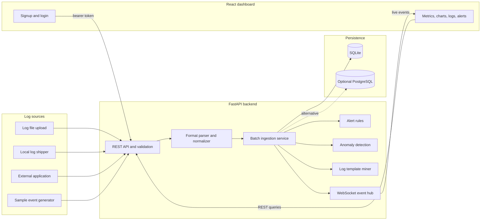

## Architecture

### Data flow

1. Log files, the log shipper, external applications, or the sample generator submit events to the backend.
2. The API validates and parses log input, normalizes fields, and stores accepted events in a batch using SQLite or PostgreSQL.
3. Alert rules and anomaly detection evaluate incoming activity; the template miner groups similar messages into patterns.
4. New log events and detections are broadcast over WebSockets. The dashboard also queries REST endpoints for historical logs, metrics, and summaries.
5. The React interface displays live metrics, charts, searchable logs, anomalies, patterns, and alert activity.
